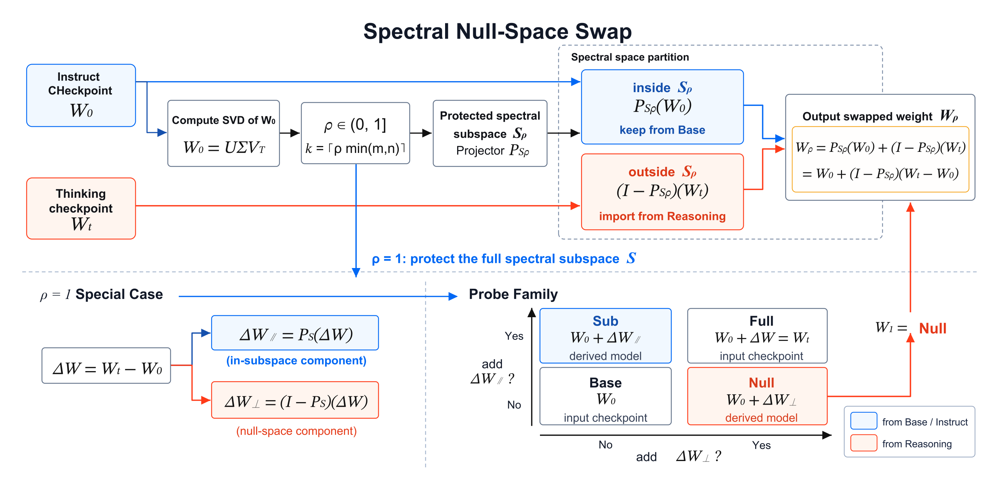

<p align="center">
    <!-- license badge -->
    <a href="https://opensource.org/licenses/Apache-2.0">
        </a>
    <!-- stars badge -->
    <a href="https://github.com/Ma-Hongbo/Spectral-Null-Space-Swap/stargazers">
        
    </a>
    <!-- pull requests badge -->
    <a href="https://github.com/Ma-Hongbo/Spectral-Null-Space-Swap/pulls">
        
    </a>
</p>

<div align="center">

S<sup>3</sup>: Spectral Null-Space Swap
===========================
_<h4>Spectral Null-Space Swap Makes Reasoning Models Efficient</h4>_


<div style="display: flex; flex-wrap: wrap; align-items: center; gap: 10px; justify-content: center;">
    <a href='https://arxiv.org/abs/2609.37976'></a>
    <a href='https://arxiv.org/pdf/2609.37976'></a>
</div>

> ##### [Hongbo Ma*](https://ma-hongbo.github.io/), [Sansheng Cao*](https://arxiv.org/search/cs?searchtype=author&query=Cao,+Sansheng), [Jiajun Fan](https://www.jiajunfan.com/), [Bangji Yang](https://openreview.net/profile?id=~Bangji_Yang1), [Ge Liu](https://www.mit.edu/~geliu/)

</div>



## News
* [2026/11/27] We release our code, evaluation suite, and mechanistic analysis scripts on GitHub.
* [2026/09/29] Our [paper](https://arxiv.org/abs/2609.37976) is available on arXiv.

---

## Repository Structure

```text
Spectral-Null-Space-Swap/
├── assets/
│   └── overview.png                    # Method overview & spectral space partition diagram
├── model/                              # Core Spectral Null Space Swap implementation
│   ├── subspace_swap.py                # Single-ratio & shard-parallel checkpoint builder
│   └── README.md                       # Layer selection rules, shard parallelism & stats schema
├── scripts/                            # Multi-ratio sweep builders & merging baselines
│   ├── build_qwen3_4b_sar_ratio_sweep.py       # Single-SVD multi-ratio builder (Qwen3-4B)
│   ├── build_qwen3_30b_a3b_sar_ratio_sweep.py  # Resumable multi-ratio builder (Qwen3-30B-A3B / Omni)
│   ├── build_qwen3_vl_sar_ratio_sweep.py       # Resumable multi-ratio builder (Qwen3-VL)
│   ├── ties_merge_safetensors.py               # Streaming TIES-Merging baseline for safetensors
│   └── README.md                               # Usage guide for sweeps and TIES baseline
├── eval/                               # Reproducible evaluation pipeline
│   ├── prepare/                        # Dataset download & normalization into JSONL
│   │   ├── prepare_gsm8k.py            # Export GSM8K test split
│   │   ├── prepare_new_vl_benchmarks.py# Prepare MathVista-testmini & Omni3D ARKitScenes
│   │   └── prepare_omni_audio_data.py  # Prepare MMAU, MMAR, and MMSU audio benchmarks
│   ├── generate/                       # Text & Vision-Language rollout generation
│   │   └── gen_vllm.py                 # Multi-GPU vLLM / Transformers runner
│   ├── omni/                           # Qwen3-Omni text & audio rollout generation
│   │   ├── gen_omni_vllm.py            # Resumable vLLM text runner for Qwen3-Omni
│   │   ├── gen_omni_audio_vllm.py      # Resumable vLLM audio runner (FFmpeg + qwen-omni-utils)
│   │   ├── gen_omni.py                 # Transformers fallback runner for Qwen3-Omni text
│   │   ├── qwen3_omni_vllm_plugin.py   # vLLM 0.9.2 model-registry bridge for Qwen3-Omni
│   │   └── sitecustomize.py            # Worker-spawn compatibility shim for vLLM 0.9.2 + TF 4.57
│   ├── grade/                          # Rule-based, verifier-assisted & multimodal graders
│   │   ├── grade.py                    # Math/Text/MMMU/LCB/BFCL grader (+ CompassVerifier)
│   │   ├── grade_new_vl.py             # MathVista & ARKitScenes (9-DoF 3D IoU mAP@0.15) grader
│   │   ├── grade_omni_audio.py         # Audio multiple-choice grader
│   │   └── utils.py                    # Symbolic SymPy / LaTeX answer equivalence checker
│   └── README.md                       # Detailed CLI reference, task formats & output schemas
├── interpretability/                   # Mechanistic analysis & probe experiments (§4.1, §5, App. A)
│   ├── entropy/                        # Attention-entropy concentration & pretraining saturation
│   ├── corollary_check/                # Empirical check of <ΔW_perp, G_perp> < 0 across 7 datasets
│   ├── hallucination/                  # SimpleQA & TruthfulQA hallucination evaluation + MoE probes
│   ├── norm_decomposition/             # Parameter- vs. function-space norms & random-subspace controls
│   └── README.md                       # Probe definitions, S3_ROOT setup & experiment commands
├── requirements.txt                    # Main environment (Text/VL eval + interpretability, Python 3.10)
└── requirements/
    ├── minimal.txt                     # Lightweight environment (checkpoint construction only)
    └── omni.txt                        # Isolated Qwen3-Omni environment (Python 3.11, vLLM 0.9.2)
```

---

## Setup

Choose the environment profile that matches your workflow. Ensure your PyTorch / vLLM wheels match the host NVIDIA driver and CUDA toolkit.

### 1. Standard Environment (Checkpoint Construction + Evaluation + Interpretability)

Tested on Linux with NVIDIA GPUs and **Python 3.10** (`PyTorch 2.9.0`, `Transformers 4.57.5`, `vLLM 0.11.2`):

```bash
git clone https://github.com/Ma-Hongbo/Spectral-Null-Space-Swap.git
cd Spectral-Null-Space-Swap

conda create -n spectral-swap python=3.10 -y
conda activate spectral-swap
python -m pip install -r requirements.txt
```

### 2. Minimal Environment (Weight Construction Only)

If you only want to build swapped or TIES-merged checkpoints without installing vLLM or evaluation packages:

```bash
python -m pip install -r requirements/minimal.txt
```

### 3. Qwen3-Omni Environment (Audio & Omni Evaluation)

Qwen3-Omni inference requires a **separate** Python 3.11 environment (`PyTorch 2.7.0`, `vLLM 0.9.2`) and `ffmpeg` on `PATH`:

```bash
conda create -n spectral-swap-omni python=3.11 -y
conda activate spectral-swap-omni
python -m pip install -r requirements/omni.txt
```

---

## Quickstart

Run all commands below from the **repository root**. This walkthrough builds a `ratio=0.5` checkpoint from `Qwen3-4B-Instruct-2507` and `Qwen3-4B-Thinking-2507`, verifies the pipeline on an 8-problem GSM8K smoke test, and then evaluates all three models head-to-head.

### Step 1: Download Base and Thinking Checkpoints

If you already have local Hugging Face checkpoints, point `BASE` and `THINKING` directly to their directories. Ensure sufficient disk space for one full output checkpoint per ratio.

```bash
BASE=checkpoints/Qwen3-4B-Instruct-2507
THINKING=checkpoints/Qwen3-4B-Thinking-2507
SWAP=checkpoints/Qwen3-4B-Swap-ratio-0.5

hf download Qwen/Qwen3-4B-Instruct-2507 --local-dir "$BASE"
hf download Qwen/Qwen3-4B-Thinking-2507 --local-dir "$THINKING"
```

### Step 2: Construct the Spectral Null Space Swap Checkpoint

```bash
python model/subspace_swap.py \
  --base "$BASE" \
  --thinking "$THINKING" \
  --out "$SWAP" \
  --ratio 0.5 \
  --device cuda:0
```

When construction finishes, `$SWAP` is a drop-in Hugging Face checkpoint saved in `float16` alongside `subspace_swap_stats.json`. Check `projected_matrices`, `max_subspace_error`, and `max_complement_error` in `subspace_swap_stats.json` to confirm all target layers were decomposed cleanly in FP32.

> **Tip:** Full FP32 SVD is computed per target matrix regardless of `--ratio`. If GPU memory is tight on large models, pass `--device cpu` or parallelize across shards (see [`model/README.md`](model/README.md)).

### Step 3: Smoke-Test Generation & Rule-Based Grading on GSM8K

Export the official GSM8K `test` split to `eval/data/GSM8K/test.jsonl`, generate 1 rollout on 8 examples, and grade with the symbolic rule checker:

```bash
python eval/prepare/prepare_gsm8k.py

OUT=results/smoke/GSM8K
python eval/generate/gen_vllm.py \
  --model "$SWAP" \
  --tasks GSM8K \
  --output-dir "$OUT" \
  --backend vllm \
  --gpus 0 \
  --dtype float16 \
  --limit 8 \
  --seeds 101 \
  --max-tokens 2048 \
  --max-model-len 4096

python eval/grade/grade.py \
  --eval-dir "$OUT" \
  --disable-verifier \
  --write-details
```

Inspect `$OUT/grading_results.json` for `avg_at_n` (mean rollout accuracy), `pass_at_n` (fraction of problems solved by at least one seed), `avg_token_length`, and `truncation_rate`. (`--max-tokens 2048` is intentionally short for a quick pipeline check and may truncate long reasoning chains.)

### Step 4: Full Head-to-Head Comparison (Instruct vs. Thinking vs. Swap)

Evaluate all three checkpoints on the full GSM8K benchmark across four seeds (`101,202,303,404`) under identical decoding budgets:

```bash
for variant in instruct thinking swap; do
  case "$variant" in
    instruct) MODEL="$BASE" ;;
    thinking) MODEL="$THINKING" ;;
    swap)     MODEL="$SWAP" ;;
  esac
  OUT="results/Qwen3-4B/$variant/GSM8K"
  python eval/generate/gen_vllm.py \
    --model "$MODEL" \
    --tasks GSM8K \
    --output-dir "$OUT" \
    --backend vllm \
    --gpus 0 \
    --dtype float16 \
    --seeds 101,202,303,404 \
    --max-tokens 32768 \
    --max-model-len 40960 || break
  python eval/grade/grade.py --eval-dir "$OUT" --disable-verifier || break
done
```

---

## Checkpoint Construction & Sweeps

| Task | Script | Highlights |
| --- | --- | --- |
| Single-ratio swap (single or multi-GPU shard parallel) | [`model/subspace_swap.py`](model/subspace_swap.py) | Supports single-file & sharded `safetensors`; dense, MoE, and Qwen3-VL layers |
| Qwen3-4B multi-ratio sweep | [`scripts/build_qwen3_4b_sar_ratio_sweep.py`](scripts/build_qwen3_4b_sar_ratio_sweep.py) | Computes SVD **once** per matrix and emits all requested ratios in one pass |
| Qwen3-30B-A3B / Qwen3-Omni sweep | [`scripts/build_qwen3_30b_a3b_sar_ratio_sweep.py`](scripts/build_qwen3_30b_a3b_sar_ratio_sweep.py) | Shard-resumable, preserves source dtype, handles Omni Instruct-only talker weights |
| Qwen3-VL multi-ratio sweep | [`scripts/build_qwen3_vl_sar_ratio_sweep.py`](scripts/build_qwen3_vl_sar_ratio_sweep.py) | Swaps both language and vision (`qkv`, `proj`, `linear_fc1/2`) target matrices |
| Streaming TIES-Merging baseline | [`scripts/ties_merge_safetensors.py`](scripts/ties_merge_safetensors.py) | Two-pass shard-streaming TIES merge without loading 30B checkpoints into RAM |

See [`model/README.md`](model/README.md) and [`scripts/README.md`](scripts/README.md) for target-weight rules, parallel shard commands, and CLI options.

---

## Evaluation Overview

| Modality / Benchmark | Data Preparation | Generation | Grading |
| --- | --- | --- | --- |
| **Text & Math** (`GSM8K`, `AIME24/25/26`, `MATH-500`, `HMMT25`, `Olympiad-Bench`, `MMLU-Pro`, `ARC-C`, etc.) | [`prepare_gsm8k.py`](eval/prepare/prepare_gsm8k.py) or `--task-path TASK=FILE` | [`gen_vllm.py`](eval/generate/gen_vllm.py) | [`grade.py`](eval/grade/grade.py) |
| **Code & Tool Use** (`LiveCodeBench`, `BFCL`) | Custom JSONL / Parquet via `--task-path` | [`gen_vllm.py`](eval/generate/gen_vllm.py) | [`grade.py`](eval/grade/grade.py) (with `references/LiveCodeBench` or `references/gorilla`) |
| **Vision-Language** (`MMMU`, `MathVista-testmini`, `ARKitScenes`) | [`prepare_new_vl_benchmarks.py`](eval/prepare/prepare_new_vl_benchmarks.py) | [`gen_vllm.py`](eval/generate/gen_vllm.py) (`--modality VL`) | [`grade.py`](eval/grade/grade.py) (`MMMU`) / [`grade_new_vl.py`](eval/grade/grade_new_vl.py) (`MathVista`, `ARKitScenes`) |
| **Qwen3-Omni Text** (`MMLU`, `GSM8K`) | JSONL question/answer file | [`gen_omni_vllm.py`](eval/omni/gen_omni_vllm.py) or [`gen_omni.py`](eval/omni/gen_omni.py) | [`grade.py`](eval/grade/grade.py) |
| **Qwen3-Omni Audio** (`MMAU`, `MMAR`, `MMSU`) | [`prepare_omni_audio_data.py`](eval/prepare/prepare_omni_audio_data.py) | [`gen_omni_audio_vllm.py`](eval/omni/gen_omni_audio_vllm.py) | [`grade_omni_audio.py`](eval/grade/grade_omni_audio.py) |

### Key Operational Notes

- **Multi-GPU data vs. tensor parallelism:** In `eval/generate/gen_vllm.py`, `--gpus 0,1 --tp 2` shards one vLLM engine across two GPUs, whereas `--gpus 0,1 --tp 1` launches two data-parallel engines over disjoint prompt shards.
- **GPU allow-list guard:** `gen_vllm.py` and `grade.py` include a cluster safety allow-list (`{0,1,2,3,5,6,7,8,9}`). Pass `--allow-other-gpus` whenever targeting physical GPU `4` or device IDs `>= 10`.
- **Dry-run inspection:** Append `--dry-run` to `gen_vllm.py` to print the resolved dataset path, example count, decoding hyperparameters, and output manifest without initializing CUDA.
- **Optional LLM verifier:** `grade.py` supports `opencompass/CompassVerifier-3B` fallback grading for responses that do not match symbolic rules; pass `--disable-verifier` for pure CPU rule grading, or `--model /path/to/CompassVerifier-3B --gpus 0` to enable it.

For complete dataset schemas, custom benchmark setup, and Qwen3-Omni vLLM plugin configuration, see [`eval/README.md`](eval/README.md).

---

## Mechanistic Interpretability

[`interpretability/`](interpretability/) contains the probe experiments and mechanistic analyses from **Section 4.1**, **Section 5**, and **Appendix A** of the paper. Decomposing the post-training update $\Delta W = W_t - W_0 = \Delta W_\parallel + \Delta W_\perp$ around the full spectral subspace of $W_0$ ($\rho = 1$) yields four probe checkpoints — **Base** ($W_0$), **Sub** ($W_0 + \Delta W_\parallel$), **Null** ($W_0 + \Delta W_\perp$), and **Full** ($W_t$) — evaluated across four modules:

| Module | Paper Section | What It Analyzes |
| --- | --- | --- |
| [`interpretability/entropy/`](interpretability/entropy/) | §5.1, App. A.1 / A.2 / A.4 | Attention-entropy concentration ($H_{\mathrm{Null}} < H_{\mathrm{Base}} < H_{\mathrm{Sub}}$) in layers 32–35, top-$k$ attention weights, per-problem scatter, and Pythia pretraining entropy saturation |
| [`interpretability/corollary_check/`](interpretability/corollary_check/) | §5.2, App. A | Empirical verification of the first-order negative alignment $\langle \Delta W_\perp, G_\perp \rangle < 0$ between the null-space update and the attention-entropy gradient across 7 math benchmarks |
| [`interpretability/hallucination/`](interpretability/hallucination/) | App. A.3 | Factual accuracy, abstention, and hallucination rates on SimpleQA & TruthfulQA, plus dense/MoE `perp` and `subonly` probe builders |
| [`interpretability/norm_decomposition/`](interpretability/norm_decomposition/) | §4.1 (Fig. 1) | Parameter-space Frobenius norms vs. function-space hidden-state displacement norms ($\|\Delta h_*^{(\ell)}\|$) and dimension-matched random-subspace controls |

All interpretability scripts read checkpoint locations from `S3_ROOT/paths2507.env` (without hardcoded cluster paths). See [`interpretability/README.md`](interpretability/README.md) for setup instructions and per-module commands.

---

## Citation

```bibtex
@misc{ma2026s3spectralnullspaceswap,
      title={$S^3$: Spectral Null-Space Swap Makes Reasoning Models Efficient}, 
      author={Hongbo Ma and Sansheng Cao and Jiajun Fan and Bangji Yang and Ge Liu},
      year={2026},
      eprint={2609.37976},
      archivePrefix={arXiv},
      primaryClass={cs.LG},
      url={https://arxiv.org/abs/2609.37976}, 
}
```
